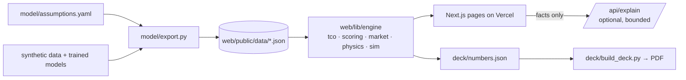

# SARATHI-X6 + VANTAGE

**The ride-service workhorse for India 2035, with a working decision system behind every number.**
Built for Maruti Suzuki XCELerate 2026 · E-Track (Round 2) by Team SARATHI.

[](https://github.com/Asadalk/sarathi-x6-vantage/actions/workflows/ci.yml)

**Live demo → https://sarathi-x6-vantage.vercel.app**

| TCO & driver earnings | Live fleet simulator | Powertrain selector |
|---|---|---|
|  |  |  |

## The problem

The case asks what the ideal ride-service vehicle for India in 2035 should be: one that serves intra-city and inter-city demand while maximising passenger comfort, driver income and fleet profitability. It asks for a market assessment, vehicle concept, powertrain strategy, specifications, TCO, an AI/connected ecosystem and a roadmap.

## Our answer

**SARATHI-X6** is a 6+1 compact MPV with a **24 kWh LFP** battery, an **80–90 kW** e-motor and a **CNG range-extender** (Bio-CNG-ready). It covers 166 km on EV and 500+ km combined, and takes **60 kW DC** (10–80% in about 20 min). **VANTAGE** is the fleet intelligence layer: SOC-aware dispatch, demand-aware charging, forecast-led repositioning and predictive maintenance, with a bounded-AI explainer.

Design rule: **optimise ₹ per productive hour, not claimed range.**

| Headline (default assumptions) | Value |
|---|---|
| 5-year TCO, CNG baseline → SARATHI-X6 | ₹26.9 L → ₹18.2 L (**₹8.7 L, 32% lower**) |
| Operator cost saving | ₹1.74 L / year |
| Driver earnings | **+₹0.98 L / year** (+6,929 paid km) |
| Paid-km share, naive → VANTAGE (simulator, 10-seed mean) | **62% → 72%** |
| Conservative preset saving | ₹5.8 L (22%) |

## What each module does

| Page | Case deliverable | What you can do |
|---|---|---|
| [`/market`](https://sarathi-x6-vantage.vercel.app/market) | 1 · Market | 2035 sizing of six segments; volume vs margin bubble chart; growth sliders |
| [`/vehicle`](https://sarathi-x6-vantage.vercel.app/vehicle) | 2 & 4 · Concept & specs | Seat-mode toggle, spec sheet with unit-tested physics, re-weightable body-style matrix |
| [`/powertrain`](https://sarathi-x6-vantage.vercel.app/powertrain) | 3 · Powertrain | CNG / Bio-CNG / HEV / PHEV / BEV / EREV on ₹/km, uptime, infrastructure, CO₂; duty-mix and weight sliders |
| [`/tco`](https://sarathi-x6-vantage.vercel.app/tco) | 5 · TCO | 30+ inputs, Round-1 / Conservative / Financed presets, stacked TCO, tornado, break-even tariff, shareable URL |
| [`/vantage`](https://sarathi-x6-vantage.vercel.app/vantage) | 6 · AI & connected | Seeded 50-car, 24-hour simulation; naive vs VANTAGE side by side; click a car for its decision card |
| [`/health`](https://sarathi-x6-vantage.vercel.app/health) | 6 · Predictive maintenance | Synthetic telematics; IsolationForest flags with reason, action and ₹ avoided |
| [`/apps`](https://sarathi-x6-vantage.vercel.app/apps) | 6 · Apps & data loop | Driver and rider app mock-ups, data-flow diagram, DPDP data governance |
| [`/roadmap`](https://sarathi-x6-vantage.vercel.app/roadmap) | 7 · Roadmap | Pilot → Localise → Scale with gates, infrastructure, partner types, risks |
| [`/assumptions`](https://sarathi-x6-vantage.vercel.app/assumptions) | — | Every input: value, unit, source or rationale, and where it's used |

## Architecture



More in [docs/ARCHITECTURE.md](docs/ARCHITECTURE.md).

## How the numbers work

- Every input lives in [`model/assumptions.yaml`](model/assumptions.yaml) with a unit and a source ID ([docs/SOURCES.md](docs/SOURCES.md), fetched 2026-10-18) or a one-line rationale. Browse it at [`/assumptions`](https://sarathi-x6-vantage.vercel.app/assumptions).
- The TypeScript engine computes everything deterministically. The optional LLM only *explains* simulator decisions from the facts it is given, and a server-side guard rejects any explanation containing a number that isn't in those facts.
- How each Round-1 claim was reproduced, corrected (₹8.8 L → ₹8.7 L) or qualified: [docs/RECONCILIATION.md](docs/RECONCILIATION.md). Design decisions: [docs/DECISIONS.md](docs/DECISIONS.md).

## Honesty note

All economics are **illustrative 2035 planning values** in real 2026 rupees. They are **not Maruti Suzuki forecasts**. Simulator demand and fleet telematics are **synthetic** (seeded, generated in `model/`). This is a student project built for XCELerate 2026.

## Run locally

```bash
# web app
cd web && npm i && npm run dev          # http://localhost:3000
npm test && npm run lint && npm run typecheck

# offline model (regenerates web/public/data/*.json)
cd model && pip install -r requirements.txt && python export.py && pytest -q tests

# deck (needs the official template in inputs/, which is not committed)
cd web && npm run deck-numbers && cd .. && node deck/shoot.mjs && python deck/build_deck.py
```

Optional: set `ANTHROPIC_API_KEY` (see `.env.example`) to enable AI-worded explanations on `/vantage`. Without it, the app uses deterministic templates.

## Tests

65 automated tests: 59 Vitest (Round-1 reproduction, TCO invariants, physics sanity, scoring crossovers, simulator determinism and robustness over 10 seeds, bounded-AI guard, shareable-URL round-trip) and 6 pytest (YAML↔JSON drift, market parity, generator determinism, health-model detection). CI runs lint, typecheck, tests and build on every push.

## Team

Ektedar Ahmad (team leader) · Asadullah Faisal · Harshita Pahadia

## License

[MIT](LICENSE)
