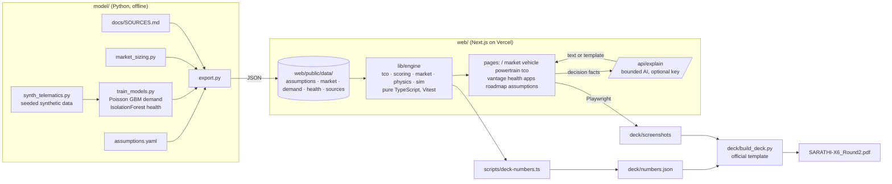

# Architecture

## Principles

- **Deterministic numbers, bounded AI.** Every number comes from pure, tested functions. `/api/explain` only rewords a decision's facts, and `lib/engine/guard.ts` rejects any output containing a number that isn't in those facts.
- **One source of truth.** Python and TypeScript read the same exported JSON, and a pytest checks the two match.
- **Deck = code output.** Slide numbers come from `deck/numbers.json`, which the same engine writes, and screenshots come from the production URL.

## Testing

| Suite | What it checks |
|---|---|
| `web/tests/tco.test.ts` | Round-1 reproduction, TCO invariants (components sum, residual subtracted, subsidy one-for-one), EMI, break-even, tornado |
| `web/tests/physics.test.ts` | DC power/C-rate limits, EV range, 500+ km, 70% EV feasibility |
| `web/tests/scoring-market.test.ts` | EREV wins mixed duty, BEV wins city-only, CNG wins upfront; market sums |
| `web/tests/sim.test.ts` | Determinism, paid + dead + charge km = total, revenue = paid km × fare, robustness over 10 seeds, explanations use fact numbers only |
| `model/tests/test_model.py` | YAML ↔ JSON drift, market parity, generator determinism, health model detection |
